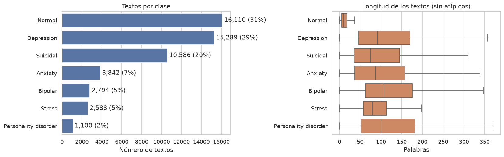
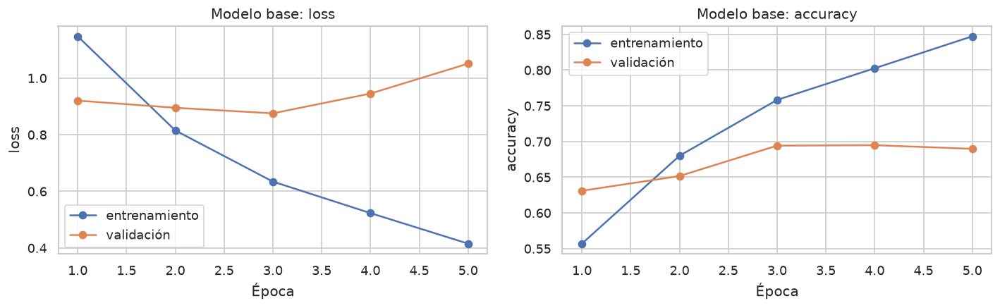
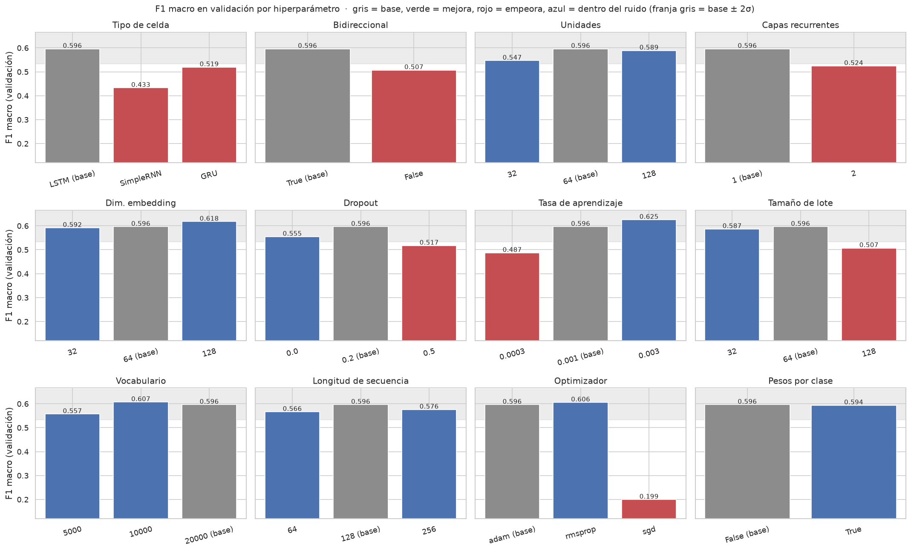
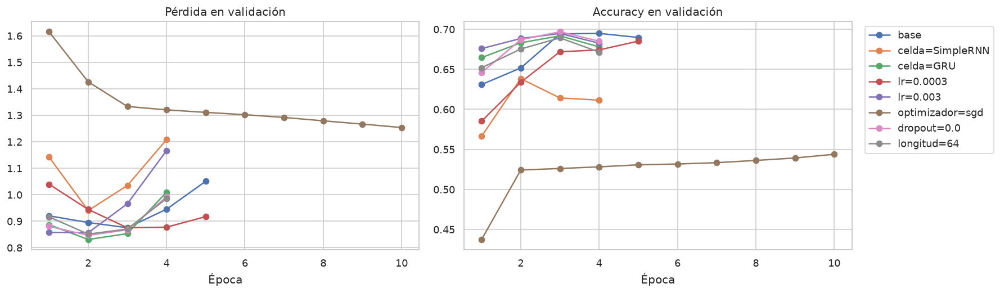
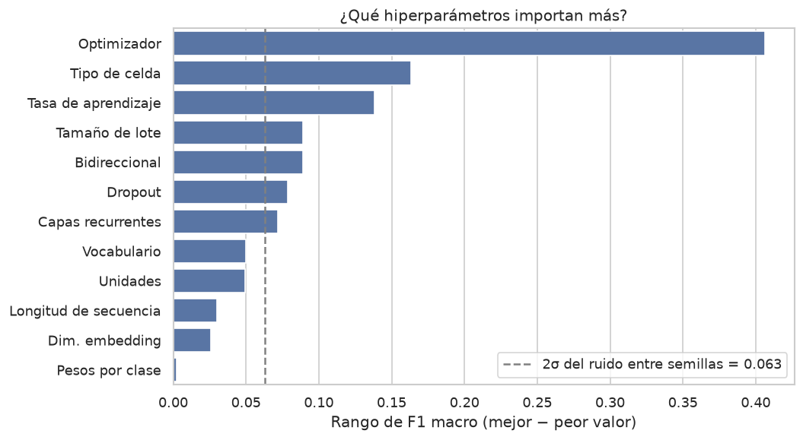
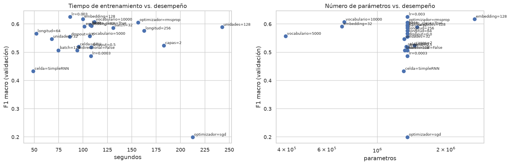
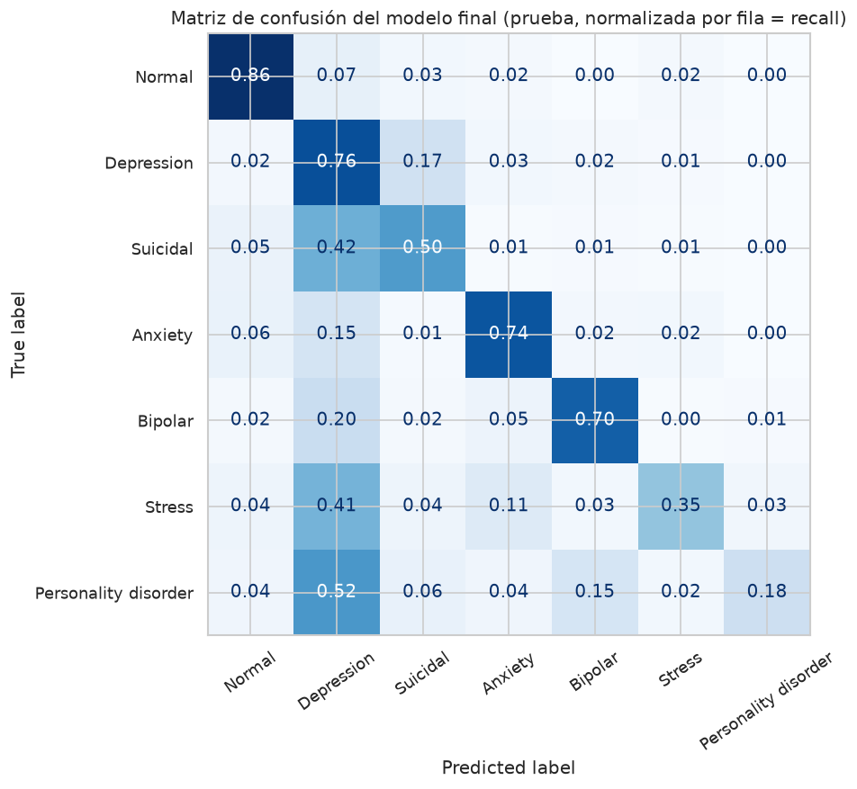

# Taller 5: Redes neuronales recurrentes para clasificar textos de salud mental

**Procesamiento de Lenguaje Natural · Maestría · Camilo García**

**Código:** <https://github.com/CamiloGarcia06/maestria-pln/tree/taller-5>, notebook [`taller_5.ipynb`](taller_5.ipynb)

> **Pregunta del taller:** ¿qué tan bien clasifica una RNN publicaciones en español en 7 estados de salud mental, y
> cuáles de sus hiperparámetros realmente importan?

## Contenido

1. [Objetivo](#1-objetivo)
2. [Los datos](#2-los-datos)
3. [Pipeline y arquitectura](#3-pipeline-y-arquitectura)
4. [Punto 1: modelo base](#4-punto-1-modelo-base)
5. [Punto 2: ajuste de hiperparámetros](#5-punto-2-ajuste-de-hiperparámetros)
6. [Punto 3: análisis comparativo](#6-punto-3-análisis-comparativo)
7. [Modelo final y evaluación en prueba](#7-modelo-final-y-evaluación-en-prueba)
8. [Conclusiones](#8-conclusiones)
9. [Limitaciones y siguientes pasos](#9-limitaciones-y-siguientes-pasos)
10. [Estructura del repositorio y cómo ejecutar](#10-estructura-del-repositorio-y-cómo-ejecutar)

---

## 1. Objetivo

| Punto del taller | Dónde |
|---|---|
| 1. Entrenar una RNN | §4 de este reporte · §4 del notebook |
| 2. Ajustar hiperparámetros | §5 · §5 y §7 del notebook |
| 3. Análisis comparativo hiperparámetros vs. desempeño | §6 · §6 del notebook |
| 4–5. Reporte escrito con enlace a GitHub | este `README.md` |

---

## 2. Los datos

Archivo: `datos/salud_mental_7clases.csv.gz`, publicaciones de redes sociales traducidas automáticamente al español
(columna `statement_es_es`) con su etiqueta (`status`).

**Limpieza:** de 53.043 filas quitamos 45 sin texto en español, los textos que aparecen con **etiquetas distintas**
(contradictorios) y los duplicados exactos (para que un mismo texto no quede en entrenamiento y en prueba).
Quedan **52.309 textos**.



- Las clases están **desbalanceadas**: Normal tiene ~14 veces más textos que Personality disorder. Por eso la métrica
  principal es el **F1 macro**, que pesa igual a todas las clases; la *accuracy* se reporta como referencia.
- Los textos «Normal» son cortos (mediana ~10 palabras); el resto son publicaciones largas. El 75 % tiene menos de
  ~120 palabras.

**División estratificada 70 / 15 / 15:** 36.615 de entrenamiento, 7.847 de validación y 7.847 de prueba. Todos los
hiperparámetros se eligen con **validación**; prueba se usa una sola vez al final.

---

## 3. Pipeline y arquitectura

```
texto ─► TextVectorization ─► Embedding ─► capa(s) recurrente(s) ─► Dropout ─► Dense(64, ReLU) ─► Dense(7)
         (minúsculas, sin       (vectores      SimpleRNN / LSTM / GRU                              logits
          puntuación, índices)   entrenables)  opcionalmente bidireccional
```

- `TextVectorization` se ajusta solo con entrenamiento.
- `mask_zero=True` hace que la RNN ignore el relleno de los textos cortos.
- Pérdida *sparse categorical cross-entropy*; hasta 10 épocas con **early stopping** sobre la pérdida de validación
  (paciencia 2), conservando los mejores pesos.

---

## 4. Punto 1: modelo base

| Hiperparámetro | Valor |
|---|---|
| Celda | LSTM bidireccional, 64 unidades, 1 capa |
| Embedding | 64 dimensiones, vocabulario de 20.000 palabras |
| Longitud de secuencia | 128 palabras |
| Dropout | 0,2 |
| Optimizador | Adam, tasa 1e-3, lote 64 |

1,35 M parámetros; ~1,8 min de entrenamiento en CPU. **F1 macro en validación 0,596, accuracy 0,694.**



La pérdida de validación toca su mínimo en la **época 3** y luego sube mientras la de entrenamiento sigue bajando:
el modelo empieza a memorizar rápido, y el *early stopping* lo frena a tiempo.

---

## 5. Punto 2: ajuste de hiperparámetros

**Diseño: un factor a la vez.** Partiendo de la base, cambiamos **un** hiperparámetro y dejamos los demás fijos, así
cada diferencia se atribuye a ese hiperparámetro. Una rejilla completa (~190.000 combinaciones) es inviable.

| Hiperparámetro | Base | Alternativas probadas |
|---|---|---|
| Tipo de celda | LSTM | SimpleRNN, GRU |
| Bidireccional | Sí | No |
| Unidades | 64 | 32, 128 |
| Capas recurrentes | 1 | 2 |
| Dim. embedding | 64 | 32, 128 |
| Dropout | 0,2 | 0,0, 0,5 |
| Tasa de aprendizaje | 1e-3 | 3e-4, 3e-3 |
| Tamaño de lote | 64 | 32, 128 |
| Vocabulario | 20.000 | 5.000, 10.000 |
| Longitud de secuencia | 128 | 64, 256 |
| Optimizador | Adam | RMSprop, SGD (momentum 0,9) |
| Pesos por clase | No | Balanceados |

**Control del ruido.** Repetimos la base con 2 semillas más. Un cambio cuenta como *mejora* o *empeora* solo si su
diferencia con la base supera **2 desviaciones estándar** de esas 3 corridas. En total: 24 entrenamientos, ~45 min.

### Resultados (F1 macro en validación, ordenados)

| Variación | F1 macro | Accuracy | Δ vs base | Veredicto (±2σ) |
|---|---|---|---|---|
| lr = 3e-3 | 0,625 | 0,688 | +0,029 | ≈ igual |
| embedding = 128 | 0,618 | 0,707 | +0,021 | ≈ igual |
| vocabulario = 10.000 | 0,607 | 0,697 | +0,011 | ≈ igual |
| optimizador = RMSprop | 0,606 | 0,692 | +0,010 | ≈ igual |
| **base** | **0,596** | **0,694** | — | — |
| pesos por clase | 0,594 | 0,659 | −0,003 | ≈ igual |
| embedding = 32 | 0,592 | 0,688 | −0,005 | ≈ igual |
| unidades = 128 | 0,589 | 0,677 | −0,007 | ≈ igual |
| lote = 32 | 0,587 | 0,690 | −0,010 | ≈ igual |
| longitud = 256 | 0,576 | 0,686 | −0,020 | ≈ igual |
| longitud = 64 | 0,566 | 0,675 | −0,030 | ≈ igual |
| vocabulario = 5.000 | 0,557 | 0,704 | −0,039 | ≈ igual |
| dropout = 0,0 | 0,555 | 0,687 | −0,042 | ≈ igual |
| unidades = 32 | 0,547 | 0,688 | −0,050 | ≈ igual |
| capas = 2 | 0,524 | 0,685 | −0,072 | empeora |
| celda = GRU | 0,519 | 0,683 | −0,077 | empeora |
| dropout = 0,5 | 0,517 | 0,676 | −0,079 | empeora |
| bidireccional = No | 0,507 | 0,672 | −0,089 | empeora |
| lote = 128 | 0,507 | 0,681 | −0,089 | empeora |
| lr = 3e-4 | 0,487 | 0,672 | −0,109 | empeora |
| celda = SimpleRNN | 0,433 | 0,638 | −0,163 | empeora |
| optimizador = SGD | 0,200 | 0,544 | −0,397 | empeora |



---

## 6. Punto 3: análisis comparativo

### 6.1 El ruido entre semillas es tan grande como los efectos

| Base, 3 semillas | F1 macro | Accuracy |
|---|---|---|
| Semilla 42 | 0,596 | 0,694 |
| Semilla 7 | 0,546 | 0,692 |
| Semilla 2024 | 0,538 | 0,692 |
| **Media ± σ** | **0,560 ± 0,032** | **0,693 ± 0,001** |

La accuracy es estable, pero el F1 macro no. Las clases pequeñas tienen pocos ejemplos, así que unos cuantos aciertos
más o menos cambian mucho su F1, y el F1 macro las pesa igual que a Normal. Resultado: el umbral de 2σ es
**±0,063**, y la mayoría de los efectos medidos cabe dentro de él.

Además, la semilla 42, la que usan todas las variaciones, fue la **mejor** de las tres. Eso favorece que las
alternativas parezcan peores. Para no depender de esa semilla también comparamos contra la **media** de las tres
(umbral 0,560 − 0,063 = 0,497). Con ese criterio solo **tres** cambios siguen siendo claramente peores:

| Cambio | F1 macro | Por qué empeora |
|---|---|---|
| **SGD** | 0,200 | Con lr = 1e-3 avanza demasiado lento: a las 10 épocas la pérdida sigue bajando. Necesitaría una tasa 10–100 veces mayor; la comparación no es justa para SGD. |
| **SimpleRNN** | 0,433 | Sin compuertas el gradiente se desvanece en secuencias de 128 pasos; la pérdida de validación sube desde la época 2. |
| **lr = 3e-4** | 0,487 | Aprende lento y el *early stopping* lo corta antes de converger. |



### 6.2 ¿Qué hiperparámetros importan más?

Importancia = rango de F1 macro entre el mejor y el peor valor probado:



| Grupo | Hiperparámetros | Rango de F1 | Lectura |
|---|---|---|---|
| **Optimización** | optimizador, tasa de aprendizaje, lote | 0,41 · 0,14 · 0,09 | Deciden **si la red logra aprender** en pocas épocas. |
| **Arquitectura recurrente** | tipo de celda, bidireccional, capas | 0,16 · 0,09 · 0,07 | Las **compuertas** (LSTM/GRU) son necesarias; leer en ambos sentidos ayuda. |
| **Regularización** | dropout | 0,08 | 0,2 es un buen punto medio; 0,5 frena el aprendizaje. |
| **Capacidad y representación** | vocabulario, unidades, longitud, embedding | 0,03–0,05 | Por debajo del ruido: el modelo es **robusto** a ellos en el rango probado. |
| **Desbalance** | pesos por clase | 0,003 | Sin efecto neto en F1 macro y la accuracy cae 3,5 puntos. |

### 6.3 Costo computacional vs. desempeño



Más parámetros o más tiempo **no** compraron desempeño:

- `unidades = 128` tarda 2,3 veces más y `capas = 2` 1,7 veces más, sin mejorar.
- `vocabulario = 10.000` usa **la mitad de parámetros** (0,71 M vs 1,35 M) con el mismo F1.
- `longitud = 64` entrena en la mitad del tiempo y pierde solo 0,03 (dentro del ruido).

---

## 7. Modelo final y evaluación en prueba

**Regla de selección:** para cada hiperparámetro tomar el mejor valor en validación **solo si mejora más de 2σ**; si
no, conservar la base. **Ninguna variación cumplió la regla**, así que el modelo final es la propia base. No elegimos
un «ganador» que podría serlo solo por azar.

| Modelo | F1 macro (val) | F1 macro (prueba) | F1 ponderado (prueba) | Accuracy (prueba) |
|---|---|---|---|---|
| Final (= base) | 0,596 | **0,605** | 0,695 | **0,699** |

El desempeño en prueba es igual al de validación: la selección no sobreajustó.

| Clase | Precisión | Recall | F1 | Textos de prueba |
|---|---|---|---|---|
| Normal | 0,913 | 0,859 | **0,885** | 2.417 |
| Depression | 0,579 | 0,757 | 0,656 | 2.294 |
| Suicidal | 0,618 | 0,501 | 0,553 | 1.588 |
| Anxiety | 0,697 | 0,736 | 0,716 | 576 |
| Bipolar | 0,746 | 0,702 | 0,723 | 419 |
| Stress | 0,578 | 0,345 | 0,432 | 388 |
| Personality disorder | 0,517 | 0,182 | **0,269** | 165 |



- **Depression funciona como «sumidero»:** el 42 % de Suicidal, el 41 % de Stress y el 52 % de Personality disorder
  se predicen como Depression. Es la segunda clase más grande y la más cercana en vocabulario a todas las demás.
- **Suicidal vs. Depression** es la confusión más relevante: ambos hablan de tristeza y desesperanza, y la
  diferencia suele estar en matices que un modelo entrenado desde cero con 36 mil textos no capta.
- Normal es fácil (F1 0,89): sus textos son cortos y de vocabulario distinto.

---

## 8. Conclusiones

1. **Punto 1.** Una LSTM bidireccional sencilla alcanza en prueba un **F1 macro de 0,605** y una **accuracy de
   0,699** sobre 7 clases (azar ≈ 0,14).
2. **Punto 2.** De 21 variaciones de 12 hiperparámetros, **ninguna mejoró la base más allá del ruido**. Las
   candidatas más prometedoras son `lr = 3e-3`, `embedding = 128`, `vocabulario = 10.000` y RMSprop.
3. **Punto 3.** Lo que más importa es la **optimización** (optimizador, tasa de aprendizaje, lote) y el **tipo de
   celda**, porque deciden si la red aprende. Los hiperparámetros de capacidad (unidades, capas, embedding,
   vocabulario, longitud) apenas cambian el desempeño y son útiles sobre todo para **reducir costo**.
4. **Lección metodológica.** Con clases desbalanceadas, una corrida por configuración no basta: el F1 macro varía
   ±0,03 solo por la semilla, el mismo orden que la mayoría de los efectos medidos.

---

## 9. Limitaciones y siguientes pasos

- **Más semillas:** repetir las candidatas con 3–5 semillas y comparar medias, no corridas sueltas.
- **SGD justo:** probarlo con una tasa de aprendizaje acorde (≈ 1e-2 a 1e-1).
- **Interacciones:** el diseño de un factor a la vez no las detecta; una búsqueda aleatoria o bayesiana sobre los 4–5
  factores más importantes sería el siguiente paso.
- **Mejor representación:** embeddings preentrenados en español (FastText) o un modelo tipo BERT probablemente
  separarían mejor Depression de Suicidal.
- **Calidad de los datos:** los textos son traducciones automáticas y algunas etiquetas pueden ser ruidosas.

---

## 10. Estructura del repositorio y cómo ejecutar

```
taller_5.ipynb                      notebook del taller (con salidas)
datos/salud_mental_7clases.csv.gz   datos
resultados/experimentos.csv         métricas de las 24 corridas
resultados/historias.json           curvas de entrenamiento por corrida
resultados/comparacion_test.csv     base vs final en prueba
resultados/reporte_clases_final.csv métricas por clase en prueba
figuras/                            figuras de este reporte
requirements.txt                    dependencias
```

```bash
python -m venv .venv && source .venv/bin/activate
pip install -r requirements.txt
jupyter nbconvert --to notebook --execute --inplace --ExecutePreprocessor.timeout=-1 taller_5.ipynb
```

El barrido completo tarda ~45 min en CPU. Si se interrumpe, al volver a ejecutar se retoma desde
`resultados/experimentos.csv` sin repetir las corridas hechas (para reiniciar de cero, borrar la carpeta
`resultados/`). Los modelos entrenados (`modelos/`) no se suben al repositorio.
