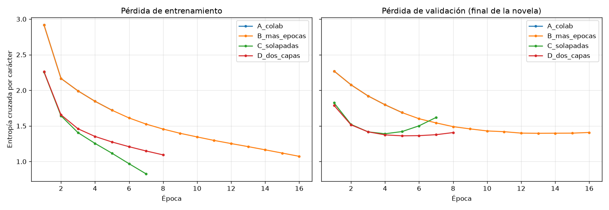
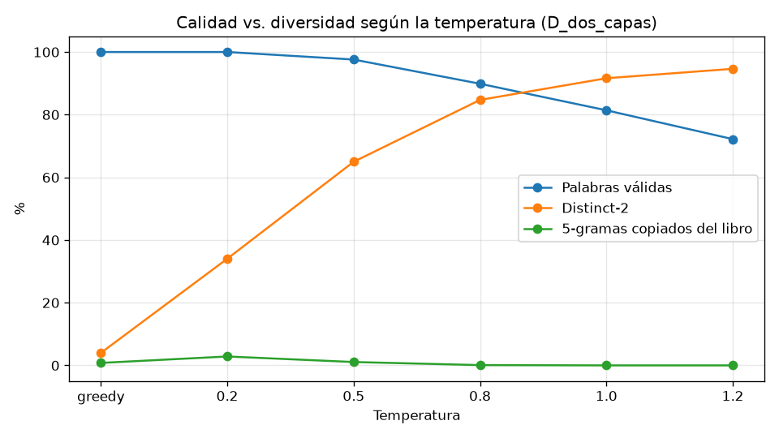
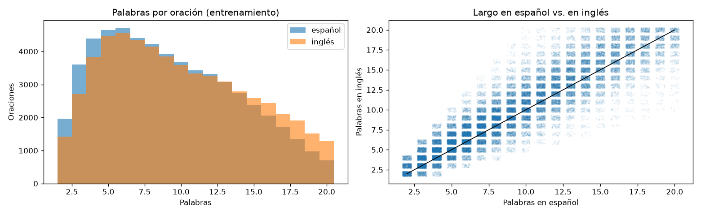
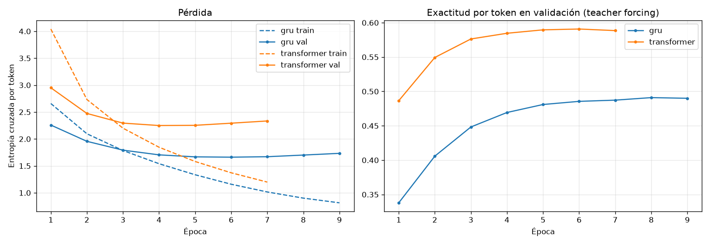
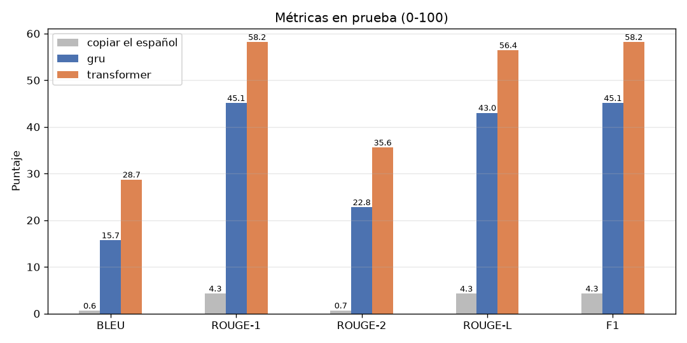
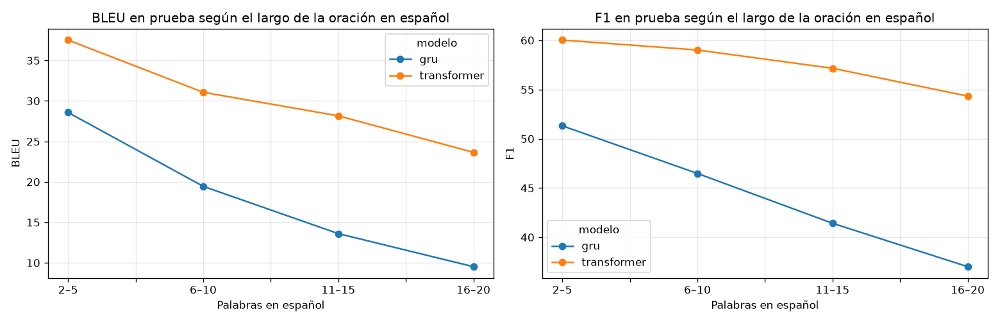

# Taller 6: Generación de texto con «María» y traducción español → inglés con seq2seq

**Procesamiento de Lenguaje Natural · Maestría · Camilo García**

**Código:** <https://github.com/CamiloGarcia06/maestria-pln/tree/taller-6>, notebooks
[`01_generacion_maria.ipynb`](01_generacion_maria.ipynb) y [`02_traduccion_es_en.ipynb`](02_traduccion_es_en.ipynb),
métricas en [`metricas.py`](metricas.py)

> **Preguntas del taller:** ¿qué tan bien aprende a escribir como Jorge Isaacs un modelo de lenguaje por caracteres
> entrenado solo con *María*? ¿Y cuánto mejora un Transformer al GRU seq2seq del colab cuando traduce del español
> al inglés, medido con BLEU, ROUGE y F1?

## Contenido

1. [Objetivo](#1-objetivo)
2. [Punto 1: generación de texto con *María*](#2-punto-1-generación-de-texto-con-maría)
3. [Punto 2: traducción español → inglés](#3-punto-2-traducción-español--inglés)
4. [Las métricas: BLEU, ROUGE y F1](#4-las-métricas-bleu-rouge-y-f1)
5. [Resultados de la traducción](#5-resultados-de-la-traducción)
6. [Conclusiones](#6-conclusiones)
7. [Limitaciones y siguientes pasos](#7-limitaciones-y-siguientes-pasos)
8. [Estructura del repositorio y cómo ejecutar](#8-estructura-del-repositorio-y-cómo-ejecutar)

---

## 1. Objetivo

| Punto del taller | Dónde |
|---|---|
| 1. Con el colab, entrenar un modelo de generación de texto con un libro leído por el grupo | §2 de este reporte · notebook 01 |
| 2. Con *Combined Data es-ES*, entrenar un seq2seq español → inglés | §3 y §5 · notebook 02 |
| 2. Implementar BLEU, ROUGE y F1 | §4 · [`metricas.py`](metricas.py), §6 del notebook 02 |
| Reporte escrito con enlace a GitHub | este `README.md` |

Partimos del colab del curso (*Deep Learning with Python*, 3.ª ed., capítulo de modelos de lenguaje y Transformer).
Mantenemos sus modelos y los **evaluamos en datos que no vieron**, que es lo que el colab no hace. Usamos el backend
TensorFlow de Keras en lugar de JAX (el código de los modelos es el mismo). Todo corrió en una RTX 4060 Ti.

---

## 2. Punto 1: generación de texto con *María*

### 2.1 El libro

*María* (Jorge Isaacs, 1867) es de dominio público. `scripts/descargar_maria.py` baja los 65 capítulos de
[es.wikisource](https://es.wikisource.org/wiki/Mar%C3%ADa_(Isaacs)) a `datos/maria.txt`: **499 mil caracteres,
88 mil palabras** (11.947 distintas) y 88 caracteres distintos con tildes, `ñ`, `¿` y `¡`. Es menos de la mitad
del Shakespeare del colab (1,1 millones de caracteres), así que el riesgo de memorizar es mayor.

**Validación.** Separamos el **último 10 % de la novela** (49 mil caracteres, los capítulos finales). El corte es
por posición para que ninguna ventana de validación se solape con una de entrenamiento.

### 2.2 Modelo y experimentos

Modelo de lenguaje **por caracteres** como el del colab: `TextVectorization(split="character")` sin estandarizar
(el modelo debe aprender mayúsculas, tildes y puntuación) → `Embedding(256)` → `GRU(1024)` → `Dropout` →
`Dense(softmax)` sobre 90 símbolos. Entrada: ventanas de 100 caracteres; salida: la misma ventana corrida un
carácter. La métrica es la entropía cruzada por carácter en validación, expresada también como **perplejidad**
(`exp(pérdida)`) y **bits por carácter**.

| Experimento | Cambio | Épocas (mejor) | Pérdida train | Pérdida val | Perplejidad val | Bits/carácter | Exactitud val |
|---|---|---|---|---|---|---|---|
| A. Colab tal cual | ventanas sin solape, dropout 0,1, 5 épocas | 5 (5) | 1,720 | 1,688 | 5,41 | 2,43 | 49,2 % |
| B. Más épocas | A + hasta 40 épocas, *early stopping* | 16 (13) | 1,210 | 1,397 | 4,04 | 2,02 | 57,8 % |
| C. Ventanas solapadas | B + `paso=25` (4× ventanas), dropout 0,3 | 7 (4) | 1,255 | 1,390 | 4,02 | 2,01 | 57,7 % |
| **D. Dos capas** | C con 2 GRU de 512 (2,8 M parámetros en vez de 4,1 M) | 8 (5) | 1,275 | **1,361** | **3,90** | **1,96** | **58,4 %** |



- **El colab se queda corto en épocas:** a las 5 épocas la pérdida de validación todavía baja con fuerza. Solo
  entrenar más (B) baja la perplejidad de 5,4 a 4,0.
- **Con un libro pequeño, el modelo memoriza rápido.** En C la pérdida de entrenamiento cae a 0,83 mientras la de
  validación sube desde la época 4: con 4 millones de parámetros y 450 mil caracteres, el GRU empieza a recitar el
  libro. El *early stopping* es lo que lo controla.
- **Más ventanas solo aceleran, no mejoran:** C llega en 4 épocas al nivel que B alcanza en 13, pero termina igual
  (1,390 contra 1,397).
- **Dos capas más pequeñas ganan** (D, 1,36): con menos parámetros sobreajusta más tarde y generaliza mejor. Es el
  modelo que usamos para generar.

### 2.3 Generación y temperatura

Como en el colab, copiamos los pesos a un modelo **paso a paso** (un carácter de entrada + el estado del GRU →
distribución del siguiente carácter). El colab elige siempre el carácter más probable (*greedy*):

> María estaba allá de la casa. -¿Conque te ha dicho que se le había pasado esta noche en el corredor de la mano que
> me había pasado en el corredor de la mano [...] de la casa de la casa de la casa de la casa de la casa [...]

El *greedy* cae en un bucle. La alternativa es **muestrear** de `p^(1/T)`: con temperatura `T` baja el modelo
se arriesga poco, y con `T` alta muestrea casi uniforme. Para elegir `T` sin depender de la impresión de leer
muestras, generamos 10 textos de 600 caracteres por temperatura y medimos:

- **Palabras válidas:** porcentaje de palabras generadas que existen en el libro (¿escribe español bien deletreado?).
- **Distinct-2:** bigramas de palabras distintos / totales (Li et al., 2016), es decir, diversidad.
- **5-gramas copiados:** porcentaje de secuencias de 5 palabras que aparecen tal cual en la novela (¿memoriza?).

| Temperatura | Palabras válidas | Distinct-2 | 5-gramas copiados |
|---|---|---|---|
| greedy | 100,0 | 4,0 | 0,8 |
| 0,2 | 100,0 | 34,0 | 2,8 |
| **0,5** | **97,6** | **65,0** | **1,1** |
| 0,8 | 89,9 | 84,7 | 0,1 |
| 1,0 | 81,4 | 91,6 | 0,0 |
| 1,2 | 72,2 | 94,6 | 0,0 |



Hay un **compromiso** entre calidad y diversidad: el *greedy* deletrea perfecto pero repite el mismo bigrama (4 %
de bigramas distintos), y desde `T = 0,8` una de cada diez palabras es inventada («frinleación», «darpeturas»).
**`T = 0,5`** es el punto de equilibrio: el 97,6 % de las palabras existe y dos de cada tres bigramas son distintos.
El modelo **no recita el libro**: a lo sumo el 2,8 % de los 5-gramas generados está en *María*. Así que escribe
combinaciones nuevas en vez de copiar pasajes.

Con `T = 0,5`, el mejor modelo (D) escribe:

> María y yo de comprender que la parte de mi madre, que ya no le perdiera yo que me entregó a mí.
> -¿Y eso con el caballo no debe decir que es el momento de que se le había pasado por lo que había precidido a
> Tránsito? -le preguntó al fin.
> -¿No lo hace conseguir para tomar así?
> -Sí, sí, ya no voy a esperar una puerta.
> -Sí -le respondí.

El estilo de la novela está ahí: diálogos con raya, «-le respondí», los personajes (María, Tránsito, Emma, «mi
padre», «mi madre») y el vocabulario de la hacienda (caballo, corredor, montaña). Lo que falta es **sentido a más
de una frase**. Un modelo por caracteres con 100 de contexto no planea un argumento. Con la misma semilla y `T`,
el modelo del colab (A) tiene solo **83,9 %** de palabras válidas frente al **96,4 %** del modelo D.

---

## 3. Punto 2: traducción español → inglés

### 3.1 Los datos: de publicaciones a pares de oraciones

*Combined Data es-ES* tiene 53.043 publicaciones de salud mental en inglés (`statement`) con su traducción
automática al español (`statement_es_es`). Es el mismo corpus del taller 5, usado ahora como **corpus paralelo**.
El problema es que las publicaciones son largas (mediana de 53 palabras, p90 de 216) y un seq2seq con GRU trabaja
con oraciones cortas (el colab usa 20 tokens). Quedarse con las publicaciones de ≤ 20 palabras dejaría solo
15.475 pares. En lugar de eso:

1. **Partimos cada publicación en oraciones** (tras `.`, `!` o `?`) en los dos idiomas.
2. Si la publicación tiene **el mismo número de oraciones** en inglés y en español (29.787 de 52.680), emparejamos
   la *i*-ésima con la *i*-ésima. Si no, la descartamos, porque no sabemos qué oración corresponde a cuál.
3. **Filtros:** 2 a 20 palabras por lado; razón de largos entre 0,5 y 2 (pares mal alineados); sin *mojibake*
   (`ðŸ'`, emojis mal codificados); texto efectivamente traducido; sin duplicados.

| Paso | Pares |
|---|---|
| Oraciones emparejadas | 107.787 |
| 2 a 20 palabras | 79.962 |
| Razón de largos 0,5–2 | 77.857 |
| Sin *mojibake* | 73.912 |
| Traducido (es ≠ en) | 72.970 |
| **Sin duplicados** | **71.242** |

Son **4,6 veces más pares** que con solo las publicaciones cortas.

**División 80 / 10 / 10 por publicación**, para que las oraciones de una publicación no queden repartidas entre
entrenamiento y prueba. Además quitamos de validación y prueba 446 oraciones en español que también estaban en
entrenamiento («me siento solo» se repite mucho), para medir traducción y no memoria. Quedan **57.257 /
6.747 / 6.792** pares.



### 3.2 Pipeline y modelos

```
español ─► TextVectorization ─► CODIFICADOR ─────────────┐
           (minúsculas, sin puntuación,                   │ resumen (GRU) o
            15.000 palabras, 20 tokens)                   │ todas las posiciones (Transformer)
                                                          ▼
[start] + inglés ─► TextVectorization ─► DECODIFICADOR ─► Dense(15.000, softmax) ─► siguiente palabra en inglés
                    (15.000 palabras, 20 + 1 tokens)
```

- **GRU seq2seq (el del colab):** codificador GRU **bidireccional** de 1.024 unidades cuyo estado final inicia
  el GRU decodificador. Toda la oración tiene que caber en **un vector** de 1.024 números (el cuello de botella).
  Tiene 34,9 M parámetros.
- **Transformer** (el siguiente modelo del mismo capítulo, Vaswani et al., 2017), con las capas de `keras_hub`:
  embeddings de tokens + posición de 256, un `TransformerEncoder` y un `TransformerDecoder` con 8 cabezas y capa
  interna de 2.048. El decodificador **atiende a cada palabra en español** en cada paso. Tiene 14,4 M parámetros.

Ambos con *teacher forcing* (el decodificador recibe el inglés correcto desplazado un token), Adam (1e-3 para el
GRU como el colab, 5e-4 para el Transformer) y *early stopping* sobre la pérdida de validación (paciencia 3).

**Traducción:** decodificación *greedy* token por token desde `[start]` hasta `[end]` o 20 tokens, igual que
`generate_translation` del colab, pero para lotes de 512 oraciones a la vez. Así la prueba completa se traduce en
~55 s en lugar de horas.



| Modelo | Épocas (mejor) | Tiempo | Exactitud por token en val | Entropía cruzada por token real en val |
|---|---|---|---|---|
| GRU | 9 (6) | 533 s | 48,6 % | 2,99 |
| Transformer | 7 (4) | 130 s | **58,5 %** | **2,44** |

**Una trampa al leer las curvas:** en la figura, la `val_loss` del GRU (1,66) es *menor* que la del Transformer
(2,25), aunque el Transformer acierta 10 puntos más de tokens. No es que el GRU sea mejor. El Transformer propaga
la máscara de relleno hasta la salida y el GRU no, así que Keras normaliza las dos pérdidas distinto: en el GRU
las posiciones de relleno cuentan en el denominador y bajan el promedio. Medidas igual, por token real (última
columna, calculada a mano en el notebook), el **Transformer gana también en pérdida**. Además entrena **4 veces más
rápido**, porque procesa la oración en paralelo en lugar de token por token.

---

## 4. Las métricas: BLEU, ROUGE y F1

Las tres están implementadas desde cero en [`metricas.py`](metricas.py) y se calculan sobre texto normalizado igual
que el objetivo del modelo (minúsculas, sin puntuación). La hipótesis es la traducción del modelo; la referencia
es el inglés original de la publicación.

| Métrica | Qué cuenta | Qué premia |
|---|---|---|
| **BLEU** (Papineni et al., 2002), de corpus | Precisión de n-gramas (n = 1..4) **recortada**: una palabra cuenta como acierto a lo sumo tantas veces como aparece en la referencia. Media geométrica de las 4 precisiones × **penalización por brevedad** si las traducciones son más cortas que las referencias | Precisión y **orden** (3- y 4-gramas) |
| **ROUGE-1 / ROUGE-2** (Lin, 2004), por oración | Traslape de unigramas / bigramas; medida F de precisión y *recall* | Cobertura de palabras / de pares de palabras |
| **ROUGE-L**, por oración | Subsecuencia común más larga (en orden, no necesariamente contigua) | Orden global sin exigir contigüidad |
| **F1 de tokens** (como en SQuAD), por oración | Intersección de bolsas de palabras; media armónica de precisión y *recall* | Palabras correctas sin importar el orden |

**Comprobación.** Sobre las traducciones del GRU en validación, nuestras implementaciones coinciden con las de
referencia (`sacrebleu` con `tokenize="none"`, `rouge-score`) hasta el tercer decimal:

| | `metricas.py` | librería |
|---|---|---|
| BLEU | 16,122 | 16,122 |
| ROUGE-1 | 45,833 | 45,832 |
| ROUGE-2 | 23,396 | 23,395 |
| ROUGE-L | 43,752 | 43,751 |

**F1 de tokens = ROUGE-1, exactamente.** No es un error. ROUGE-1 cuenta los unigramas comunes con conteo
recortado (el mínimo de los dos conteos), que es la misma intersección de bolsas de palabras del F1 de tokens, y
su medida F es la misma media armónica. Reportamos las dos porque el taller las pide, pero son **una sola medida**.
Lo que añade información es comparar **F1 (sin orden) con BLEU y ROUGE-2 (con orden)**.

---

## 5. Resultados de la traducción

Evaluación en el conjunto de **prueba** (6.792 oraciones), usado una sola vez. Como **línea base trivial**,
«traducimos» copiando la oración en español: sirve para saber desde dónde empieza la escala (coinciden nombres,
números, «no»...).

| Modelo | BLEU | ROUGE-1 | ROUGE-2 | ROUGE-L | F1 | Largo medio (palabras) |
|---|---|---|---|---|---|---|
| Copiar el español | 0,6 | 4,3 | 0,7 | 4,3 | 4,3 | 9,4 |
| GRU seq2seq (colab) | 15,7 | 45,1 | 22,8 | 43,0 | 45,1 | 10,4 |
| **Transformer** | **28,7** | **58,2** | **35,6** | **56,4** | **58,2** | 9,8 |
| *Referencia* | | | | | | *10,1* |



- **El Transformer casi duplica el BLEU del GRU** (28,7 contra 15,7) y le saca 13 puntos en todas las demás
  métricas. Como guía aproximada, un BLEU de ~30 en oraciones cortas de redes sociales es una traducción comprensible
  con errores; menos de 20 suele ser difícil de entender.
- **La brecha es mayor en las métricas de orden:** el GRU acierta el 45 % de las palabras (F1) pero pocas
  secuencias (ROUGE-2 de 22,8, BLEU de 15,7). Sabe *de qué* habla la oración pero la reescribe. El Transformer
  conserva mejor la estructura.
- Los dos producen traducciones del **largo correcto** (~10 palabras, como la referencia), así que la penalización
  por brevedad de BLEU no influye.

### 5.1 ¿Dónde falla el GRU? El cuello de botella



| Palabras en español | Oraciones | BLEU GRU | BLEU Transformer | F1 GRU | F1 Transformer |
|---|---|---|---|---|---|
| 2–5 | 1.621 | 28,6 | 37,5 | 51,3 | 60,0 |
| 6–10 | 2.510 | 19,5 | 31,1 | 46,5 | 59,0 |
| 11–15 | 1.839 | 13,6 | 28,2 | 41,4 | 57,2 |
| 16–20 | 822 | 9,5 | 23,6 | 37,0 | 54,3 |

Con oraciones cortas los dos se parecen (9 puntos de BLEU de diferencia). Con 16–20 palabras **el BLEU del GRU cae
a un tercio** (de 28,6 a 9,5) mientras el Transformer pierde solo un 37 % (de 37,5 a 23,6). En F1 el Transformer
casi no se degrada (de 60 a 54). Es lo que predice la arquitectura: el GRU resume la oración entera en un vector
de tamaño fijo, que se satura cuanto más larga es. La atención del Transformer consulta cada palabra del español
cuando la necesita.

### 5.2 Ejemplos de prueba

| Español | Referencia | GRU | Transformer |
|---|---|---|---|
| Hoy es mi último día. | today is my last day | today is my last day | today is my last day |
| Y será como si nunca hubiera existido, como si nunca hubiera experimentado nada de esto. | amp it will be like i have never existed like i have never experienced any of this | and it will always be like if i never had it ever would have done with this | and it will be like i have never existed like i never experienced anything |
| espero que mi nivel de estrés baje cuando mi tía se vaya... | im hoping my stress level will go down when my aunt is gone | i hope my [UNK] [UNK] my [UNK] when the 31st | i hope my [UNK] level of stress when my aunt is going to go |
| Muy buen ambiente escuchando a Raki cantar esta canción | very good mood listening to raki sing this song | very busy story [UNK] [UNK] [UNK] this morning | very good link to [UNK] sing this song |
| siéntate a mi lado. | come sit next to me | i am going to miss my partner | stressed on my side |
| Siento bajone." | feeling low | i feel [UNK] | i feel [UNK] |

- En oraciones frecuentes en el corpus («hoy es mi último día») los dos aciertan.
- En oraciones largas, el GRU produce inglés fluido pero **pierde el contenido** («nunca hubiera existido» → «never
  had it ever»), mientras el Transformer lo traduce casi palabra por palabra.
- Los dos emiten **`[UNK]`**: los nombres propios (Raki) y las palabras raras quedan fuera del vocabulario de
  15.000 palabras. En validación el 2,8 % de los tokens en inglés son desconocidos.
- Las **expresiones idiomáticas** fallan («siéntate a mi lado» → «stressed on my side»). Además, a veces la
  referencia no es una traducción literal («Siento bajone» ← «feeling low»; «amp» es un `&amp;` mal decodificado
  del original). El español es traducción automática del inglés, así que el corpus tiene ruido en los dos lados.

---

## 6. Conclusiones

1. **Punto 1.** Un GRU por caracteres entrenado con *María* aprende la ortografía, la puntuación de diálogo, los
   personajes y el vocabulario de la novela. La perplejidad baja de 5,4 (colab) a **3,9 caracteres** (dos capas
   de 512, *early stopping*). Con un libro de medio millón de caracteres, **el problema es el sobreajuste**: el
   colab sin validación no lo ve, y la mejora vino de más épocas con parada temprana y de un modelo con menos
   parámetros, no de más capacidad.
2. **La temperatura importa tanto como el modelo:** el *greedy* del colab deletrea perfecto pero se repite
   (4 % de bigramas distintos). **`T = 0,5`** equilibra 97,6 % de palabras reales con 65 % de bigramas
   distintos, sin copiar la novela (≤ 3 % de 5-gramas copiados).
3. **Punto 2.** Partir las publicaciones en oraciones alineadas multiplicó por 4,6 los pares de entrenamiento
   (71 mil). Con ellos, el **Transformer supera claramente al GRU seq2seq del colab: BLEU 28,7 contra 15,7, ROUGE-L
   56,4 contra 43,0 y F1 58,2 contra 45,1**, con menos de la mitad de parámetros y en un cuarto del tiempo.
4. **La ventaja del Transformer crece con el largo de la oración** (con 16–20 palabras su BLEU es 2,5 veces el del GRU), lo que confirma el cuello de botella del vector único del GRU.
5. **Sobre las métricas:** el F1 de tokens y ROUGE-1 son matemáticamente la misma medida. La comparación útil es
   entre las que ignoran el orden (F1) y las que lo exigen (BLEU, ROUGE-2). Además, las `val_loss` de Keras no se
   pueden comparar entre modelos que manejan la máscara de relleno de forma distinta.

---

## 7. Limitaciones y siguientes pasos

- **La referencia es traducción automática.** El español de *Combined Data* lo generó una máquina a partir del
  inglés, así que el modelo aprende a **invertir ese traductor**, con su ruido (`&amp;` → «amp», textos sin
  traducir). Las métricas miden parecido con ese inglés, no calidad humana de traducción.
- **Una sola referencia por oración.** BLEU y ROUGE castigan sinónimos correctos («lonely» por «alone»). Una
  métrica semántica (BERTScore, COMET) o una evaluación humana completaría el análisis.
- **Vocabulario de palabras cerrado:** los `[UNK]` limitan el techo. Subpalabras (BPE/WordPiece), o afinar un
  modelo preentrenado como MarianMT o mBART, eliminarían los desconocidos.
- **Decodificación greedy:** *beam search* suele subir uno o dos puntos de BLEU.
- **Una corrida por configuración** (semilla 42): no medimos la varianza entre semillas. Las diferencias del
  punto 2 (13 puntos de BLEU) son mucho mayores que esa varianza típica; en el punto 1, C y B (1,390 contra 1,397)
  son un empate.
- **Generación:** el modelo por caracteres no tiene coherencia más allá de una frase. Un Transformer de palabras o
  afinar un GPT en español sobre *María* daría textos con más sentido.

---

## 8. Estructura del repositorio y cómo ejecutar

```
01_generacion_maria.ipynb           punto 1 (con salidas)
02_traduccion_es_en.ipynb           punto 2 (con salidas)
metricas.py                         BLEU, ROUGE y F1 implementados desde cero
scripts/descargar_maria.py          baja «María» de es.wikisource a datos/maria.txt
datos/maria.txt                     el libro (dominio público)
datos/combined_data_es-ES.csv.gz    Combined Data es-ES
resultados/lm_experimentos.csv      experimentos A–D del modelo de lenguaje
resultados/lm_temperatura.csv       métricas de generación por temperatura
resultados/lm_muestras.json         textos generados por temperatura
resultados/traduccion_test.csv      métricas en prueba
resultados/traduccion_por_largo.csv métricas por largo de oración
resultados/traduccion_ejemplos.csv  ejemplos de traducción
resultados/*_historias.json         curvas de entrenamiento
figuras/                            figuras de este reporte
requirements.txt                    dependencias (Python 3.12)
```

```bash
python3.12 -m venv .venv && source .venv/bin/activate
pip install -r requirements.txt
python scripts/descargar_maria.py          # opcional: datos/maria.txt ya está en el repositorio
jupyter nbconvert --to notebook --execute --inplace --ExecutePreprocessor.timeout=-1 01_generacion_maria.ipynb
jupyter nbconvert --to notebook --execute --inplace --ExecutePreprocessor.timeout=-1 02_traduccion_es_en.ipynb
```

En una RTX 4060 Ti el notebook 01 tarda ~3 min y el 02 ~15 min (el GRU seq2seq es lo más lento, ~9 min). Sin GPU
cambiar `tensorflow[and-cuda]` por `tensorflow` en `requirements.txt` y contar con bastante más tiempo. Si
TensorFlow no encuentra las librerías de CUDA instaladas por pip, agregarlas a la ruta antes de ejecutar:
`export LD_LIBRARY_PATH=$(echo .venv/lib/python3.12/site-packages/nvidia/*/lib | tr ' ' ':')`.
Los modelos entrenados (`modelos/`) no se suben al repositorio.

**Referencias.** Chollet, F. y Watson, M. (2025). *Deep Learning with Python* (3.ª ed.). Manning · Isaacs, J. (1867).
*María* · Li, J. et al. (2016). A Diversity-Promoting Objective Function for Neural Conversation Models. NAACL ·
Lin, C.-Y. (2004). ROUGE: A Package for Automatic Evaluation of Summaries · Papineni, K. et al. (2002). BLEU: a
Method for Automatic Evaluation of Machine Translation. ACL · Vaswani, A. et al. (2017). Attention Is All You Need.
NeurIPS.
