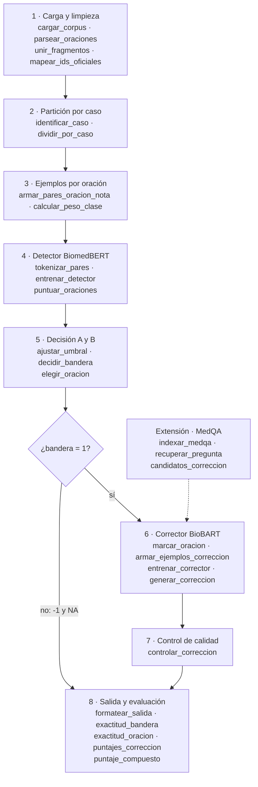

# Taller 7: Pipeline para detectar y corregir errores médicos en notas clínicas (MEDIQA-CORR 2024)

**Procesamiento de Lenguaje Natural · Maestría · Grupo 6 · Camilo García**

**Código:** <https://github.com/CamiloGarcia06/maestria-pln/tree/taller-7>. La revisión del dataset está en
[`scripts/revisar_dataset.py`](scripts/revisar_dataset.py) y sus cifras en
[`resultados/revision_dataset.json`](resultados/revision_dataset.json).

> **Pregunta del taller:** dado un caso clínico que puede traer un error médico, ¿cómo armamos con modelos de
> Hugging Face un pipeline que diga **si hay error** (subtarea A), **en qué oración está** (subtarea B) y **cómo se
> corrige** (subtarea C)?

## Contenido

1. [Objetivo](#1-objetivo)
2. [Lo que tomamos de los artículos](#2-lo-que-tomamos-de-los-artículos)
3. [Revisión del dataset y qué decide en el pipeline](#3-revisión-del-dataset-y-qué-decide-en-el-pipeline)
4. [El pipeline](#4-el-pipeline)
5. [Evaluación y valores de referencia](#5-evaluación-y-valores-de-referencia)
6. [Limitaciones y siguientes pasos](#6-limitaciones-y-siguientes-pasos)
7. [Estructura del repositorio y cómo ejecutar](#7-estructura-del-repositorio-y-cómo-ejecutar)

---

## 1. Objetivo

| Punto del taller | Dónde |
|---|---|
| 1. Leer los artículos (MEDEC y WangLab en MEDIQA-CORR 2024) | §2 |
| 2. Revisar el dataset `MEDIQA-CORR-2024-MS-TrainingData.csv` | §3 · [`scripts/revisar_dataset.py`](scripts/revisar_dataset.py) |
| 3. Plantear un pipeline con un modelo de Hugging Face, con las funciones a programar en cada caja | §4 |
| Reporte escrito con enlace a GitHub | este `README.md` |

La tarea son las tres subtareas de MEDIQA-CORR 2024 sobre la misma nota:

| Subtarea | Salida | Métrica oficial |
|---|---|---|
| A. Bandera de error | `1` si la nota tiene un error, `0` si no | exactitud |
| B. Oración con error | id de la oración, `-1` si no hay error | exactitud |
| C. Corrección | la oración corregida, `NA` si no hay error | ROUGE-1, BERTScore, BLEURT y su promedio (*AggregateScore*) |

---

## 2. Lo que tomamos de los artículos

**MEDEC** (Ben Abacha et al., 2024, arXiv:2412.19260) presenta el benchmark. Cada nota es correcta o trae **un solo
error** de cinco tipos: diagnóstico, manejo, tratamiento, farmacoterapia u organismo causal. La parte **MS**, que es
nuestro CSV, se armó con preguntas del examen médico de EE. UU. (MedQA). Los anotadores metieron en el caso la
respuesta correcta (nota sin error) o una incorrecta (nota con error), **en la mitad o al final del texto**. La parte
**UW** son notas reales de hospital y exige un acuerdo de uso. Evaluaron LLM con un *prompt*: el mejor en detección
fue Claude 3.5 Sonnet (70 % en A, 66 % en B) y el mejor en corrección fue o1-preview (*AggregateScore* 0,70). Dos
médicos sacaron 80 % y 72 % en A. Dos conclusiones nos sirven:

- **Detectar y corregir son habilidades distintas:** el mejor detector quedó último corrigiendo. Por eso separamos
  las dos tareas en modelos distintos.
- **Las métricas de corrección no ven sinónimos:** «agammaglobulinemia de Bruton» y «agammaglobulinemia ligada al
  X» son la misma enfermedad y ROUGE las castiga. Por eso medimos también con BERTScore y BLEURT.

**WangLab** (Toma et al., ClinicalNLP 2024) ganó las tres subtareas: 86,5 % en A, 83,6 % en B y 0,789 en C, con
GPT-4 y DSPy. Para MS **recupera con TF-IDF la pregunta de MedQA** de la que salió la nota. Sus opciones de
respuesta convierten la corrección en elegir una opción. Para UW encadena tres módulos (detectar → localizar →
corregir) y un **control de calidad**: si el ROUGE-L entre la oración original y la corregida baja de 0,7, descarta
la corrección. Tomamos de ellos la cadena de tres pasos, el control de calidad y la recuperación de MedQA como
extensión.

---

## 3. Revisión del dataset y qué decide en el pipeline

El CSV tiene **2.189 notas** y 9 columnas: `Text ID`, `Text`, `Sentences` (una oración por línea con su id),
`Error Flag`, `Error Sentence ID`, `Error Sentence`, `Corrected Sentence` y `Corrected Text`. No trae el tipo de
error. Cada hallazgo termina en una decisión de diseño:

| Hallazgo | Cifra | Decisión en el pipeline |
|---|---|---|
| Clases casi balanceadas | 1.219 con error (55,7 %), 970 sin error | Siempre decir «hay error» da **55,7 %** en A: es la base que hay que superar |
| Una nota tiene muchas oraciones y solo una mala | 12,6 oraciones por nota en promedio (máx. 48), 27.673 en total | El detector clasifica **cada oración**: 1.219 positivas contra 26.454 negativas (1 de cada 23). Se entrena con peso de clase ≈ 21,7 |
| **Las notas vienen en pares** | 1.240 casos; 934 tienen una versión correcta y otra con error (86 % de las notas está en un par) | Separar entrenamiento y validación **por caso** (`GroupKFold`). Si una versión queda en entrenamiento y la otra en validación, el modelo ya vio el caso y la validación miente |
| **El error suele ir al final** | 62,3 % de los errores está en la última oración; solo 9,4 % en la primera mitad | «Elegir siempre la última oración» es la base de B. **No** damos la posición como rasgo al modelo: es un efecto de cómo se armó MS y no se cumple en notas reales (UW) |
| La segmentación corta oraciones | 1.289 notas tienen «oraciones» de 3 palabras o menos (`"100/68 mm"`, `"Hg."`); 350 traen líneas sin id | Unir los fragmentos para el modelo, pero **guardar el mapa a los ids oficiales**: la subtarea B se califica con el id original |
| La corrección es un cambio corto | 3,5 palabras cambiadas en promedio (mediana 3, máx. 24) | El corrector **reescribe una oración**, no la nota. El control de calidad rechaza salidas que se alejen mucho de la original |
| Vocabulario médico | ver tabla siguiente | Elegir modelos **biomédicos** de Hugging Face |

**Vocabulario contra largo de secuencia.** Son dos números distintos y conviene no confundirlos:

- **Tamaño del vocabulario:** cuántos tokens distintos conoce el tokenizador. Fija el tamaño de la tabla de
  *embeddings*; con BiomedBERT son 30.522 filas × 768 = 23,4 M parámetros. Además decide **cómo se parte una palabra**.
- **Largo de secuencia:** cuántos tokens tiene **un ejemplo**. Fija el relleno y el corte (`max_length`), no los
  parámetros.

| Modelo (tokenizador) | Vocabulario | «Haemophilus influenzae metoprolol» | Tokens por nota (media / máx.) | Par oración + nota (máx.) | Largo máximo del modelo |
|---|---|---|---|---|---|
| BiomedBERT | 30.522 | `haem ##ophilus influenzae met ##oprol ##ol` | 173 / 414 | 425 | 512 |
| BioBART-v2 | 85.401 | `Haemophilus influenzae metoprolol` | 189 / 482 | 497 | 1.024 |
| Flan-T5 (referencia general) | 32.100 | `Ha e m ophil us influenza e me top rol o l` (12 piezas) | 204 / 516 | 521 | 512 |

El modelo general **despedaza** los términos médicos y además se pasa de 512 tokens en algunas notas. Los dos
biomédicos dejan las palabras casi enteras y **toda nota cabe sin cortar**. Usamos `max_length=512` con relleno
dinámico por lote: un lote se rellena hasta su nota más larga, no hasta 512.

---

## 4. El pipeline

Usamos **dos modelos de Hugging Face**, uno por habilidad, como sugiere MEDEC:

- **Detector-localizador** (subtareas A y B): [`microsoft/BiomedNLP-BiomedBERT-base-uncased-abstract-fulltext`](https://huggingface.co/microsoft/BiomedNLP-BiomedBERT-base-uncased-abstract-fulltext),
  un codificador BERT preentrenado desde cero con PubMed. Lo ajustamos para decir si **una oración**, leída
  **junto a toda la nota**, es la que tiene el error.
- **Corrector** (subtarea C): [`GanjinZero/biobart-v2-large`](https://huggingface.co/GanjinZero/biobart-v2-large),
  un BART codificador-decodificador preentrenado con PubMed. Lo ajustamos para escribir la oración corregida a
  partir de la nota con la oración mala marcada. Es la misma familia que usamos en el proyecto final (BART para
  corrección gramatical), ahora con vocabulario médico.



### Caja 1 · Carga y limpieza

| Función | Qué hace |
|---|---|
| `cargar_corpus(ruta) -> DataFrame` | Lee el CSV y normaliza tipos (`Error Sentence ID` a entero, `NA` a `None`) |
| `parsear_oraciones(columna) -> dict[int, str]` | Convierte `"0 texto\n1 texto"` en `{0: "texto", 1: "texto"}` y descarta las líneas sin id |
| `unir_fragmentos(oraciones) -> list[Segmento]` | Pega a la oración anterior los fragmentos que no son oración (`"mm"`, `"Hg."`, `"100/68 mm"`) para que el modelo lea frases completas |
| `mapear_ids_oficiales(segmentos) -> dict[int, list[int]]` | Guarda qué ids oficiales cubre cada segmento unido, para devolver el id que exige la subtarea B |

### Caja 2 · Partición por caso

| Función | Qué hace |
|---|---|
| `identificar_caso(oraciones) -> str` | Clave del caso: las dos versiones de un caso comparten la primera oración |
| `dividir_por_caso(df, k=5, semilla) -> list[tuple[índices, índices]]` | `GroupKFold` por caso: las dos versiones de un caso caen siempre en el mismo lado |

Las 574 notas del conjunto de validación oficial de MS (repositorio de MEDEC) **quedan como prueba final**. Así
nuestras cifras se pueden comparar con las de los artículos.

### Caja 3 · Ejemplos por oración

| Función | Qué hace |
|---|---|
| `armar_pares_oracion_nota(nota) -> list[Par]` | Por cada segmento produce `(oración candidata, nota completa, etiqueta)`, con etiqueta 1 solo si el segmento contiene el id de error |
| `calcular_peso_clase(pares) -> float` | `negativos / positivos ≈ 21,7` para `pos_weight` de la pérdida |

La oración va **acompañada de la nota** porque el error solo se nota en contexto. «El organismo causal es
*Haemophilus influenzae*» es una frase correcta por sí sola; es error porque el cuadro de la nota (fiebre de un día,
esputo amarillo verdoso, consolidación lobar) apunta a neumococo.

### Caja 4 · Detector BiomedBERT

| Función | Qué hace |
|---|---|
| `tokenizar_pares(pares, tokenizador) -> BatchEncoding` | `[CLS] oración [SEP] nota [SEP]`, `truncation="only_second"`, `max_length=512` (el par más largo tiene 425 tokens) |
| `entrenar_detector(pares_train, pares_val) -> modelo` | `AutoModelForSequenceClassification(num_labels=1)` con `BCEWithLogitsLoss(pos_weight)`, AdamW con tasa 2e-5, 3–4 épocas y *early stopping* según la exactitud de A en validación |
| `puntuar_oraciones(modelo, nota) -> list[float]` | Probabilidad de error de cada oración de una nota |

Arquitectura, con la forma del tensor (lote *B*, largo *L* ≤ 512):

| Capa | Salida | De dónde sale el número |
|---|---|---|
| `input_ids` | (B, L) | tokens del par oración + nota |
| Embedding | (B, L, 768) | vocabulario 30.522 × dimensión 768 |
| 12 bloques Transformer | (B, L, 768) | 12 cabezas de atención de 64 dims (12 × 64 = 768) |
| Vector `[CLS]` | (B, 768) | primera posición |
| Dropout + Dense | (B, 1) | 768 → 1 logit: «esta oración es la del error» |

### Caja 5 · Decisión de las subtareas A y B

| Función | Qué hace |
|---|---|
| `decidir_bandera(probs, umbral) -> int` | `1` si la oración más sospechosa supera el umbral |
| `elegir_oracion(probs, mapa_ids) -> int` | Id oficial de la oración más sospechosa, o `-1` si la bandera es 0 |
| `ajustar_umbral(probs_val, etiquetas_val) -> float` | Barre umbrales en validación y se queda con el de mayor exactitud en A |

Un solo modelo resuelve A y B: la bandera es «¿alguna oración pasa el umbral?» y la oración es la de mayor
probabilidad. El umbral importa porque MEDEC vio que los LLM **ven errores donde no hay** (alto *recall*, baja
precisión); con el umbral controlamos ese balance.

### Caja 6 · Corrector BioBART

| Función | Qué hace |
|---|---|
| `marcar_oracion(nota, id) -> str` | Encierra la oración sospechosa entre `<err>` y `</err>` (dos tokens nuevos; se agrandan los *embeddings* con `resize_token_embeddings`) |
| `armar_ejemplos_correccion(df) -> Dataset` | Entrada: la nota marcada. Objetivo: `Corrected Sentence`. Solo las 1.219 notas con error |
| `entrenar_corrector(train, val) -> modelo` | `AutoModelForSeq2SeqLM` con `Seq2SeqTrainer`, entropía cruzada por token, tasa 3e-5; el mejor punto según ROUGE-1 en validación |
| `generar_correccion(modelo, nota_marcada, num_beams=4) -> str` | Genera la oración corregida, con `max_new_tokens=96` |

Arquitectura: el codificador lee la nota marcada, (B, L ≤ 512) → (B, L, 1024). El decodificador genera la oración
token por token y en cada paso devuelve (B, T, 85.403): el vocabulario de 85.401 más `<err>` y `</err>`.

### Caja 7 · Control de calidad

| Función | Qué hace |
|---|---|
| `controlar_correccion(original, corregida, umbral=0,7) -> str` | Como WangLab: si el ROUGE-L entre la oración original y la corregida baja de 0,7, el modelo reescribió de más y se devuelve la original. Si la corrección es igual a la original, no corrigió nada y se marca para revisión |

### Caja 8 · Salida y evaluación

| Función | Qué hace |
|---|---|
| `formatear_salida(text_id, bandera, id, correccion) -> str` | Línea `text_id bandera id corrección` (con `-1 NA` si no hay error), el formato del *shared task* |
| `exactitud_bandera(pred, real) -> float` | Subtarea A |
| `exactitud_oracion(pred, real) -> float` | Subtarea B, sobre todas las notas (acertar `-1` también cuenta) |
| `puntajes_correccion(pred, ref) -> dict` | ROUGE-1, BERTScore (`microsoft/deberta-xlarge-mnli`), BLEURT-20 y su promedio, solo donde ambas son oraciones |
| `puntaje_compuesto(pred, ref) -> float` | Regla oficial: 1 si ambas son `NA`, 0 si solo una lo es y la métrica en otro caso |

### Extensión · Recuperar la pregunta de MedQA

| Función | Qué hace |
|---|---|
| `indexar_medqa(dataset)` | Índice TF-IDF del dataset de Hugging Face `GBaker/MedQA-USMLE-4-options` |
| `recuperar_pregunta(nota, k=3) -> list[Pregunta]` | Las preguntas de MedQA más parecidas a la nota |
| `candidatos_correccion(pregunta) -> list[str]` | Las opciones de respuesta, que se pasan al corrector como pistas o se usan para reordenar sus *beams* |

Es la idea que hizo ganar a WangLab en MS. La dejamos como extensión porque aprovecha cómo se construyó MS (desde
MedQA) y no sirve para notas reales.

---

## 5. Evaluación y valores de referencia

Cada etapa se compara con una base sencilla y con lo publicado:

| Sistema | A. Bandera | B. Oración | C. *AggregateScore* |
|---|---|---|---|
| Siempre «hay error» | 55,7 % (train) | — | — |
| Siempre «la última oración» (solo notas con error) | — | 62,3 % (train) | — |
| Claude 3.5 Sonnet, *prompt* (MEDEC, prueba) | 70,2 % | 65,6 % | 0,280 |
| o1-preview, *prompt* (MEDEC, prueba) | 67,5 % | 61,4 % | 0,698 |
| Médico #1 / #2 (MEDEC, prueba) | 79,6 % / 71,6 % | 65,9 % / 66,8 % | 0,453 / 0,712 |
| WangLab, GPT-4 + DSPy (prueba MEDIQA-CORR) | 86,5 % | 83,6 % | 0,789 |
| **Nuestro pipeline** | por medir | por medir | por medir |

El pipeline debe superar las dos bases. En B, «la última oración» ya acierta el 62 % de las notas con error: si
el detector no la supera, solo aprendió la posición.

---

## 6. Limitaciones y siguientes pasos

- **Solo hay datos MS.** Las notas reales (UW) piden un acuerdo de uso. Un modelo ajustado con MS puede aprender la
  plantilla del examen y no los errores reales. MEDEC lo muestra: o1-preview baja de 73 % en MS a 58 % en UW.
- **No hay tipo de error en el CSV,** así que no podemos medir el *recall* por tipo (diagnóstico, manejo, etc.)
  como hace MEDEC.
- **Las métricas de corrección castigan sinónimos.** Conviene revisar a mano una muestra de correcciones con
  puntaje bajo antes de descartar un modelo.
- **Siguiente paso:** programar las cajas 1–5 y medir A y B contra las dos bases; después, el corrector y el
  control de calidad.

---

## 7. Estructura del repositorio y cómo ejecutar

```
taller-7/
├── README.md                     este reporte
├── requirements.txt              dependencias de la revisión del dataset
├── datos/                        MEDIQA-CORR-2024-MS-TrainingData.csv (no se versiona)
├── scripts/revisar_dataset.py    cifras de la §3
└── resultados/revision_dataset.json
```

El CSV es la parte MS de MEDEC (<https://github.com/abachaa/MEDEC>) y va en `datos/`.

```bash
uv venv --python 3.12 && source .venv/bin/activate
uv pip install -r requirements.txt
python scripts/revisar_dataset.py
```

**Referencias.** Ben Abacha, A. et al. (2024). *MEDEC: A Benchmark for Medical Error Detection and Correction in
Clinical Notes*. arXiv:2412.19260. · Toma, A. et al. (2024). *WangLab at MEDIQA-CORR 2024: Optimized LLM-based
Programs for Medical Error Detection and Correction*. Proceedings of the 6th Clinical NLP Workshop, 616–623.
