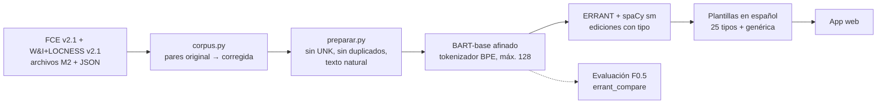

# Corrector gramatical explicado para hispanohablantes

Proyecto final del curso de Procesamiento de Lenguaje Natural. Un estudiante hispanohablante escribe un texto en inglés; el sistema le devuelve el texto corregido y, por cada corrección, una explicación en español del tipo de error («faltó el sujeto: en inglés el pronombre no se omite»). A diferencia de Grammarly, el foco no es solo corregir sino explicar, con atención a los errores que el análisis mostró más frecuentes en hispanohablantes.

- **Tarea principal — Generación de lenguaje:** BART-base afinado reescribe la oración con errores en su versión corregida (la literatura lo plantea como traducción monolingüe *inglés con errores → inglés correcto*).
- **Tarea complementaria — POS tagging:** ERRANT 3.0.2, sobre las etiquetas de spaCy, alinea entrada y salida, extrae cada edición y la clasifica (`R:VERB:FORM`, `M:PRON`, …); ese tipo elige la plantilla de explicación.

## Pipeline



| Paso | Qué hace | Ejemplo real (FCE test, hispanohablante) |
|---|---|---|
| 1. Corpus | Lee los M2 oficiales y los alinea con los ensayos (L1, nota, autor) | `As you know I am in charge for organise the conference …` |
| 2. Preparación | Aplica las ediciones del anotador 0, destokeniza y filtra | entrada `… in charge for organise …` → destino `… in charge of organising …` |
| 3. BART | Genera la oración corregida (el destino de referencia es lo que debe aprender) | `As you know, I am in charge of organising the conference …` |
| 4. ERRANT | Extrae y tipa las ediciones (aquí, las de la anotación oficial) | `+ ,` `M:PUNCT`; `for → of` `R:PREP`; `organise → organising` `R:VERB:FORM`; `left → leave` `R:VERB:FORM` |
| 5. Explicación | Plantilla por tipo de error | `R:PREP`: «*in charge* se construye con *of*» |

## Estructura

```
proyecto-final/
├── Makefile                 comandos del entorno (make help)
├── requirements.txt         dependencias con versión fija
├── infra/                   Dockerfile, compose.yaml, servicio CDI de la GPU
├── scripts/descargar_datos.sh
├── src/
│   ├── corpus.py            lectura de M2 + JSON → tablas de oraciones y ediciones
│   ├── texto.py             destokenizador (tokens del M2 → texto natural)
│   ├── preparar.py          conjuntos de entrenamiento y evaluación
│   └── graficas.py          estilo de las figuras
├── tests/                   pytest (make test)
├── notebooks/
│   ├── 01_analisis_datos.ipynb     calidad y descripción de los corpus
│   └── 02_analisis_tareas.ipynb    análisis dirigido a las dos tareas
├── figuras/  resultados/    salidas de los notebooks (PNG y CSV)
├── presentacion/            entrega 1
├── datos/                   (no versionado) crudos/ y procesados/
└── modelos/                 (no versionado) checkpoints de BART
```

## Requerimientos

- Linux con GPU NVIDIA de 16 GB (probado en RTX 4060 Ti 16 GB, driver 615, CachyOS).
- Docker 29 + Compose v2 y `nvidia-container-toolkit` 1.20.
- Tailscale (Jupyter solo escucha en la IP de Tailscale) y `make`, `openssl`, `curl`.
- Unos 20 GB de disco: imagen ~12,4 GB, corpus ~150 MB, cada checkpoint ~560 MB.

Dentro de la imagen (Python 3.12): PyTorch 2.14.1 (CUDA 13.0), transformers 5.20.2, accelerate 1.15.0, datasets 5.1.0, ERRANT 3.0.2, spaCy 3.8.16 con `en_core_web_sm` y `en_core_web_lg`, JupyterLab. Ver `requirements.txt`.

## Instalación paso a paso

Todo se ejecuta desde `proyecto-final/` en la máquina con GPU.

```bash
git clone <repo> && cd <repo>/proyecto-final

# 1. Una sola vez: especificación CDI de la GPU, regenerada en cada arranque (ver «Problemas conocidos»)
sudo install -m 644 infra/nvidia-cdi-generate.service /etc/systemd/system/
sudo systemctl enable --now nvidia-cdi-generate.service

# 2. Configuración local: token de Jupyter, IP de Tailscale, UID/GID (crea infra/.env, no versionado)
make env

# 3. Construir y levantar Jupyter; imprime la URL para abrir desde otro equipo de la tailnet
make up

# 4. Comprobar que PyTorch ve la GPU (debe terminar en «bf16 True · matmul ok True»)
make gpu

# 5. Descargar los corpus de BEA-2019 (sin registro) en datos/crudos/
make datos

# 6. Tests y análisis (los notebooks se ejecutan en orden; el 02 usa tablas del 01)
make test
make analisis

# 7. Conjuntos de entrenamiento y evaluación en datos/procesados/entrenamiento/
make preparar
```

Otros comandos: `make url`, `make logs`, `make status`, `make shell`, `make restart`, `make down`. El contenedor se reinicia solo con la máquina (`restart: unless-stopped`).

## Datos

| Corpus | Uso | Licencia |
|---|---|---|
| FCE v2.1 (BEA-2019) | train, dev, test | no comercial |
| W&I v2.1 (BEA-2019), niveles A, B, C | train, dev | no comercial |
| LOCNESS (nativos) | solo referencia | no comercial, **no redistribuible** |

Por las licencias, `datos/` no se sube al repositorio: `make datos` lo descarga.

## Análisis (resumen)

Los dos notebooks verifican las cifras de la entrega 1 y traducen cada hallazgo en una decisión. Las tablas completas están en `resultados/decisiones.csv` y `resultados/decisiones_tareas.csv`.

- **Volumen:** 62.658 pares de train (FCE 28.350 + W&I 34.308), 5.587 de dev, 2.695 de test; 108.065 correcciones; 34,4 % de oraciones sin error (se conservan: enseñan a no tocar lo que está bien).
- **Calidad:** ERRANT 3.0.2 reproduce el 86,9 % de las ediciones anotadas (precisión 85,5 %, mismo tipo en el 94,9 %).
- **Hispanohablantes (FCE):** no cometen más errores sino otros; 11 de 52 tipos difieren significativamente: sustantivo sobrante (×1,78), pronombre omitido (×1,74), puntuación (×1,69), forma verbal (×1,30), ortografía (×1,24), preposición (×1,17).
- **Generación:** BART recibe texto natural (ida y vuelta exacta en 99,34 %); el 86 % de los tokens se copia, por eso la métrica es F0.5 sobre ediciones y no exactitud; largo máximo 128 tokens BPE (cubre el 99,95 %); el tokenizador de BART se usa sin cambios.
- **Splits:** dev se parece a train; el test de FCE (exámenes de 2001) tiene más errores que train (11,35 vs 9,76 por 100 tokens), así que será más difícil. Se mantiene el split oficial.
- **POS tagging:** `en_core_web_sm` basta (el `lg` mejora 0,04 puntos); 25 tipos de error cubren el 90 % de las ediciones → 25 plantillas más una genérica por operación.
- **Techo de evaluación:** aun con las correcciones de referencia, ERRANT sobre texto destokenizado llega a F0.5 = 0,855; los resultados del modelo se leen contra ese techo.

## Preparación de los datos (`make preparar`)

| Conjunto | Contenido | Tamaño | Uso |
|---|---|---|---|
| `train.jsonl` | FCE train + W&I train, sin pares con `UNK` (2.779) ni duplicados exactos (3.625; el análisis cuenta 3.636 porque incluye los que también tienen `UNK`) | 56.254 pares | afinar BART |
| `dev_seleccion/` | W&I dev + FCE dev **sin** hispanohablantes | 5.054 oraciones | elegir el checkpoint |
| `fce_dev_es/` | FCE dev, solo hispanohablantes | 533 oraciones, 44 textos | evaluación aparte |
| `fce_test/` | FCE test completo | 2.695 oraciones, 194 textos | evaluación final |
| `fce_test_es/` | FCE test, solo hispanohablantes | 224 oraciones, 20 textos | evaluación aparte |

Cada conjunto de evaluación trae `entrada.jsonl` (texto natural para BART), `orig.txt` (tokens del M2, para `errant_parallel`) y `ref.m2` (anotación oficial, para `errant_compare`). Los hispanohablantes de FCE dev salen de la selección del checkpoint para que su resultado no quede sesgado por haberlo elegido con ellos. Los pares con `UNK` se excluyen porque su destino conserva un error que el anotador marcó sin corregir.

Evaluar una salida del modelo (`hyp.txt`, una oración por línea, tokenizada como `orig.txt`):

```bash
errant_parallel -orig orig.txt -cor hyp.txt -out hyp.m2
errant_compare -hyp hyp.m2 -ref ref.m2
```

Con `hyp.txt = orig.txt` (copiar la entrada) el resultado es F0.5 = 0: es la línea base.

## Entrenamiento (siguiente paso)

Afinado completo de los pesos de `facebook/bart-base` (139 M parámetros), sin prompting ni LoRA: `Seq2SeqTrainer`, AdamW con lr ≈ 3e-5, lote 32 en bf16, entre 3 y 10 épocas, checkpoint elegido por F0.5 en `dev_seleccion` (nunca en test), generación con beam search. En la prueba de humo, el lote 32 procesa 234 pares/s con 4,4 GB de pico (≈ 4 min por época); el lote 64 rozó el límite de memoria. Los checkpoints quedan en `modelos/`.

## Problemas conocidos

- **PyTorch: `CUDA unknown error`.** La especificación CDI (`/etc/cdi/nvidia.yaml`) guarda el número de dispositivo de `nvidia-uvm`, que el kernel puede cambiar entre reinicios. El servicio `infra/nvidia-cdi-generate.service` la regenera antes de que arranque Docker. Si aun así falla: `sudo nvidia-ctk cdi generate --output=/etc/cdi/nvidia.yaml` y `docker compose --env-file infra/.env -f infra/compose.yaml up -d --force-recreate`.
- **`nvidia-smi` funciona pero PyTorch no.** Falta la capability `compute` en `compose.yaml` (monta `libcuda`); ya está incluida.
- **Memoria de la GPU compartida.** Si en la máquina corren juegos (Steam/gamescope ocupa ~600 MB), conviene cerrarlos antes de entrenar.
- **`make` en una shell donde `UID` es de solo lectura (bash).** Por eso `.env` usa `HOST_UID`/`HOST_GID`.
